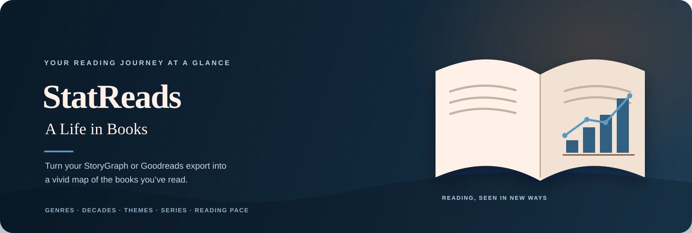

<div align="center">



<br />

[](https://atandritc.github.io/StatReads/)

<br />

`NO BUILD STEP` &nbsp; · &nbsp; `RUNS IN YOUR BROWSER` &nbsp; · &nbsp; `GOODREADS + STORYGRAPH`

</div>

<br />

> **A Life in Books** &nbsp; Turn a Goodreads or StoryGraph export into an interactive portrait of what you read: the genres, places, eras, and series that shape your reading life.

---

## ◈ Explore

<div align="center">

| &nbsp;01&nbsp; **Discover** | &nbsp;02&nbsp; **Explore** | &nbsp;03&nbsp; **Personalize** | &nbsp;04&nbsp; **Contribute** |
|:---:|:---:|:---:|:---:|
| [Dashboard](#your-reading-dashboard) | [Charts & maps](#charts--maps) | [Overrides](#make-the-data-yours) | [Community data](#share-a-correction) |

</div>

## Your reading dashboard

StatReads is a static, browser-based dashboard for your **StoryGraph** or **Goodreads** reading history. Upload a CSV export and it enriches your books with public metadata, then brings your reading patterns together in one place.

| **At a glance** | **Across time & place** | **Books, authors & series** |
|:---|:---|:---|
| Books read, unique authors, countries represented, pages, and average rating. | Reading pace, publication-year trends, decade favorites, genre and theme breakdowns, and an interactive world map. | Author profiles, most-read books, and series progress—including series you define yourself. |

## Charts & maps

Explore your history from several angles:

- **Reading over time** — Compare books read and average ratings by publication year; see monthly pages-per-day pace.
- **Genres & themes** — Compare most-read and highest-rated categories, inspect rating distributions, and explore your genre profile.
- **Decades & countries** — Find the eras you read most or rate highest, and explore book origins on a clickable world map.
- **Series & authors** — Browse complete or almost-complete series, author profiles, and books ordered by rereads.
- **Book details** — View cover art, publication information, metadata sources, and the data behind each chart.

The dashboard includes light and dark themes, interactive tooltips, and animated charts. Theme preference and manual corrections are saved in your browser.

## Get started

1. Export your reading data as a CSV from [StoryGraph](https://www.thestorygraph.com/) or [Goodreads](https://www.goodreads.com/).
2. [Open StatReads](https://atandritc.github.io/StatReads/).
3. Drop the CSV onto the upload area, or choose the file.
4. Review and confirm the imported books; StatReads will build your dashboard.

The app recognizes the standard export formats from those services. You can try the included sample file at `sample-data/goodreads-export.csv`.

## Run it locally

StatReads has no build step, package install, or application server. To serve it locally with Python:

```bash
git clone https://github.com/atandritC/StatReads.git
cd StatReads
python3 -m http.server 8000
```

Open <http://localhost:8000> in your browser. An internet connection is needed for book metadata, author information, map rendering, and community submissions.

## Make the data yours

Public book APIs can return incomplete or incorrect metadata. Use the **Override Manager** in the dashboard to correct or add details for a book or author. Your manual values take priority over API results and are stored in your browser.

Overrides can be exported as JSON. You can also queue corrections for the community and submit them together when you’re ready.

## Share a correction

Community corrections can be submitted from the dashboard either as a GitHub issue or by email through Web3Forms. The email option does not expose the maintainer’s address or open your email app. A name and reply address are optional, so a correction can be submitted anonymously.

### Configure email submissions in a fork

Email submissions are already configured for the original project. If you fork StatReads and want submissions sent to your inbox:

1. Create a form at [Web3Forms](https://web3forms.com/) and verify the destination email address.
2. Copy the access key provided by Web3Forms.
3. Replace `EMAIL_RELAY_ACCESS_KEY` in `script.js` with your key.

The key is used in public browser code and is not a secret. Configure it only for the destination you control. If the key is missing or invalid, the app offers a copy or JSON download fallback; failed submissions stay queued for retry.

## Data, privacy & services

StatReads has no account system or project backend. Your CSV is read by the app in your browser. To add book and author details, the browser makes requests to public services:

- [Open Library](https://openlibrary.org/) — editions, publication years, covers, and subjects
- [Google Books](https://books.google.com/) — author and book details, covers, page counts, and series clues
- [Wikidata](https://www.wikidata.org/) — author photos and nationality
- [Google Charts](https://developers.google.com/chart) — interactive world map

Metadata, theme preference, and manual overrides may be cached in browser storage. If you choose to submit community corrections, the selected correction data is sent through GitHub or Web3Forms. See each service’s privacy terms for how it handles requests.

## How it’s built

StatReads is plain **HTML, CSS, and JavaScript**—no framework, bundler, or dependency installation. It uses CSS custom properties for theming, the Canvas API for custom charts, and batched API lookups with fallbacks to enrich book metadata.

## Known limitations

- Metadata completeness depends on the public book services; results can be missing or incorrect. Use the override manager to correct them.
- The world map and book enrichment need an internet connection.
- Browser storage is local to the browser and device; it does not sync between them. Clearing site data removes locally saved preferences and corrections.
- StatReads currently supports the standard Goodreads and StoryGraph CSV exports, not arbitrary reading spreadsheets.

---

<div align="center">

**StatReads** &nbsp; · &nbsp; Your reading journey, at a glance.

[Open the dashboard →](https://atandritc.github.io/StatReads/)

</div>
